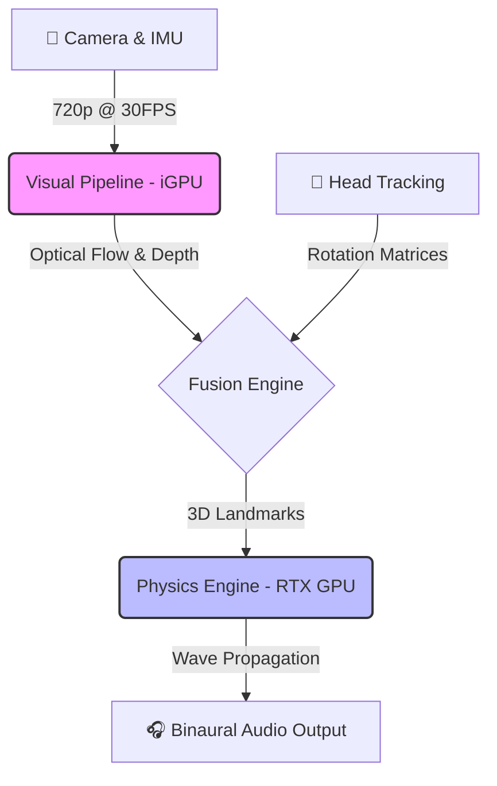

# Real-time Spatial Pulse Engine


### *Sensory Augmentation for the Visually Impaired*

**The "Pulse"** is an advanced assistive augmented reality system designed to bridge the gap between traditional white canes and full environmental awareness. By converting a live camera feed into high-fidelity 3D spatial audio, it allows visually impaired users to "hear" the geometry of a room, detect obstacles at head height, and navigate dynamic environments using echolocation principles.

-----

## Key Features

  * **Hyper-Realistic Spatial Audio:** Uses a custom CUDA-accelerated physics engine to simulate Doppler shift, wall reflections, and room reverb in real-time.
  * **Visual-to-Audio Mapping:**
      * **Pitch:** Maps vertical elevation (High Pitch = Floor, Low Pitch = Ceiling/Obstacles).
      * **Volume:** Maps horizontal (XY) proximity. Objects at feet sound as loud as objects at head level.
  * **Hybrid Compute Architecture:**
      * **Vision (iGPU):** Runs Optical Flow (RAFT) and Depth Estimation on integrated graphics to prevent stalls.
      * **Audio (RTX GPU):** Dedicated high-priority CUDA streams for sub-15ms audio synthesis.
  * **Precision Tracking:** Fuses Visual Odometry (RAFT) with IMU data for drift-free 6DoF head tracking.
  * **Safety-First Design:** "Fail-Loud" architecture instantly cuts audio if tracking is lost, preventing false confidence.

-----

## System Architecture

The system follows a strict **Sense-Process-Sonify** pipeline, distributed across hardware to maximize throughput.



-----

## 🛠️ Installation & Setup

### Prerequisites

  * **OS:** Windows 10/11 or Linux (Ubuntu 20.04+)
  * **GPU:** NVIDIA RTX 2060 or higher (6GB+ VRAM)
  * **Python:** Version 3.9 (Strict requirement for CuPy/PyTorch compatibility)
  * **Drivers:** CUDA Toolkit 11.8+

### Step-by-Step Guide

1.  **Clone the Repository**

    ```bash
    git clone https://github.com/YourUsername/SpatialPulse.git
    cd SpatialPulse
    ```

2.  **Install Core Dependencies (PyTorch with CUDA)**

    ```bash
    pip install torch torchvision --index-url https://download.pytorch.org/whl/cu118
    ```

3.  **Install Acceleration Libraries**

    ```bash
    pip install cupy-cuda11x opencv-python sounddevice numpy scipy
    ```

4.  **Download Model Weights**
    Ensure `raft-small.pth` and your depth estimation weights are placed in the `models/` directory.

5.  **Configure Camera**

      * Install **IPWebcam** (or compatible app) on your Android device.
      * Set resolution to **Low/Medium** (recommended for 11 FPS cap).
      * Start server and note the IP (e.g., `http://192.168.1.5:8080`).

-----

## Usage

### 1\. Calibration (Critical Step)

Before running the main engine, you must calibrate the camera to ensure the floor/ceiling pitch mapping is accurate.

```bash
python calibrate.py
```

  * Follow the on-screen prompts to capture the chessboard pattern.
  * Press `S` to save the calibration matrix.

### 2\. Start the Engine

Run the main pipeline script. Ensure your headphones are connected **before** starting.

```bash
python vsa_pipeline.py
```

### 3\. Understanding the Audio Cues (User Guide)

| Sound Characteristic | Environmental Meaning | Action Required |
| :--- | :--- | :--- |
| **Steady Pulse** | System is active and tracking. | Safe to proceed slowly. |
| **High Pitch** 🐦 | Object is **BELOW** you (Floor). | Normal walking surface. |
| **Low Pitch** 🐻 | Object is **ABOVE** you (Ceiling/Overhang). | **DUCK\!** Danger at head height. |
| **Loud Volume** 🔊 | Object is horizontally **CLOSE** (XY distance). | Stop or change direction. |
| **Reverb/Echo** 🏰 | You are near a wall or corner. | Use as a navigational landmark. |
| **Left/Right Pan** ↔️ | Obstacle direction. | Steer away from the sound. |

> **⚠️ SAFETY WARNING:** This software is a prototype. Do not use in traffic, construction zones, or high-risk environments. Always carry a white cane as a backup.

-----

## File Structure Breakdown

  * **`vsa_pipeline.py`**
      * The **Brain**. Orchestrates the threads, manages GPU streams, and handles the main event loop.
  * **`highp_spatial_landmarks.py`**
      * The **Physics Engine**. Contains the CUDA kernels for Doppler shift, HRIR convolution, and room acoustics.
  * **`tracker.py`**
      * The **Eyes**. Handles RAFT optical flow and feature tracking. Runs primarily on the iGPU/CPU to save RTX resources.
  * **`depth_client.py`** & **`depth_check.py`**
      * Handles monocular depth estimation and Z-sampling for 3D coordinate generation.
  * **`calibrate.py`**
      * Utility for camera intrinsics calibration.

-----

## Troubleshooting & Known Issues

### Low Framerate (FPS)

  * **Issue:** Visual system running at \~11 FPS.
  * **Reason:** This is intentional\! We cap the visual tracking to spare resources for the audio engine (which needs \<15ms latency).
  * **Fix:** Scan your head slowly to "paint" the room with sound.

### Audio Stuttering

  * **Fix 1:** Ensure `sounddevice` block size is set to **512** or **1024** in `vsa_pipeline.py`.
  * **Fix 2:** Close other GPU-heavy apps (Chrome, Games).
  * **Fix 3:** Check that the dedicated NVIDIA GPU is not being used for the visual tracker (check Task Manager).

### Thermal Throttling

  * **Issue:** After \~45 mins, performance drops.
  * **Fix:** Restart the script to clear GPU memory cache and reset thermal limits.

-----

## License

This project uses components from Open Source libraries (OpenCV, PyTorch).

  * **Code:** MIT License
  * **HRIR Database:** CIPIC Interface (Research Use Only)

-----

### *Bridging the Dark with Sound.*
